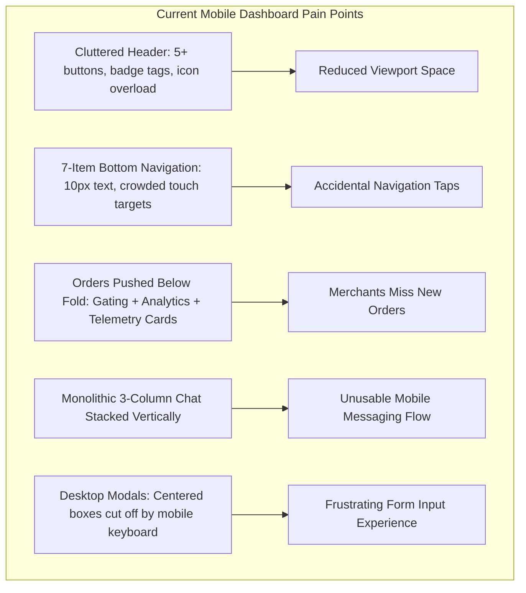
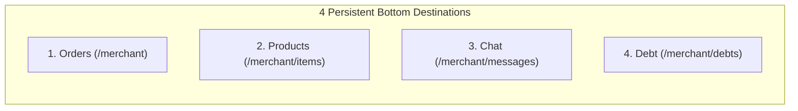
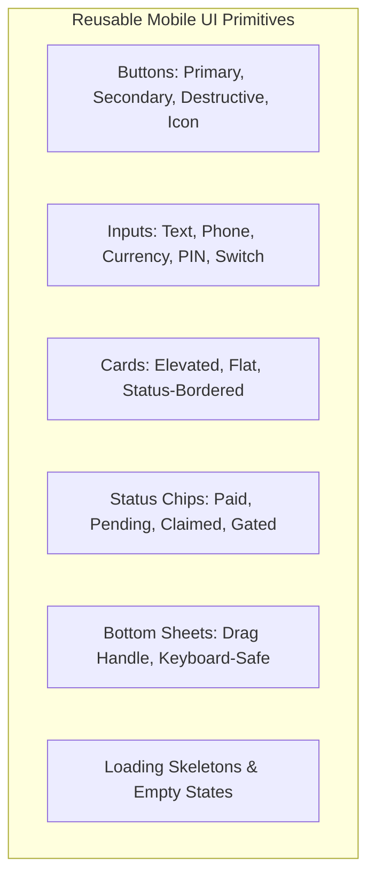
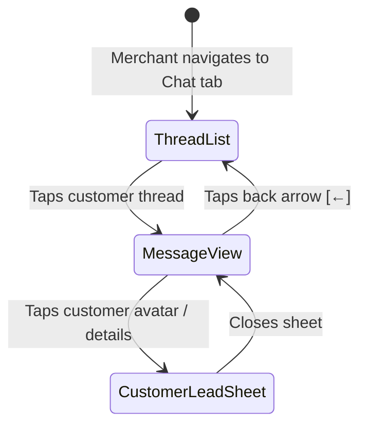
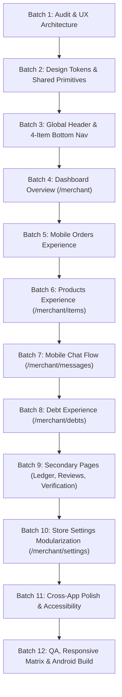

# Merchant Dashboard Mobile UI/UX Redesign — Design System & Implementation Plan (`design.md`)

## 1. Project Overview and Design Goals

### 1.1 Executive Summary
**zlik** is a modern high-speed mobile-first social commerce platform enabling merchants across Nigeria and emerging markets to run stores, sell products, manage customer orders, track debts, and chat with shoppers directly through web and native mobile applications.

The goal of this redesign is to transform the entire merchant dashboard experience into a **world-class, sleek, minimal, intuitive, and visually exceptional mobile application interface** that rivals top-tier consumer apps such as Instagram, Shopify Mobile, and Apple Store, while strictly preserving all existing backend logic, routes, database contracts, and core merchant workflows.

### 1.2 Core Objectives
1. **True Mobile-First Architecture:** Move away from responsive desktop layouts squeezed onto phone screens. Design natively for smartphone viewports (360px–428px), single-thumb reachability, and touch ergonomics.
2. **Simplified Navigation Architecture:**
   - **Persistent 4-Item Bottom Navigation:** Exactly four primary destinations: **Orders**, **Products**, **Chat**, **Debt**.
   - **Secondary Navigation Drawer:** A clean, accessible hamburger drawer housing all remaining secondary destinations (Overview, Sales Ledger, Reviews Moderation, Store Settings, Trust Verification, Audio toggles, Storefront QR, and Account Sign Out).
   - **Clean Contextual Header:** Replace cluttered top headers with a minimalist 56px bar prioritizing store identity, page context, and the menu trigger.
3. **Radical Simplicity & Cognitive Clarity:** A first-time merchant should understand their dashboard immediately without instructions. Present critical data first (pending orders, payment claims, urgent customer messages) while progressively disclosing deep analytics and secondary options.
4. **Preservation of Established Brand Identity:** Elevate the established obsidian and emerald color palette (`#08110D`, `#19D98B`, `#087A50`, `#00F076`, `#F8FAF8`) into a cohesive design token system with refined typography, balanced whitespace, and subtle micro-interactions.
5. **Implementation Feasibility & Batch Roadmap:** Structure the redesign into 12 structured batches that allow incremental implementation, thorough testing, zero regressions, and backward-compatible desktop rendering.

---

## 2. Existing Application Audit

### 2.1 Technology Stack & Rendering Architecture
- **Server & Routing:** Fastify (Node.js + TypeScript) in `src/server.ts` and modular controllers in `src/modules/`.
- **View Engine:** EJS (`ejs` 3.1.10) with layout templates in `src/views/merchant/`.
- **CSS Framework:** Tailwind CSS (loaded via CDN runtime script `https://cdn.tailwindcss.com`).
- **Typography:** Google Fonts (`Inter` for body/labels, `Montserrat` for brand headers/display, `JetBrains Mono` for currency/codes/timestamps).
- **Client Scripts:** Vanilla JavaScript with DOM manipulation, WebSocket / polling for live chat, Web Audio API / HTML5 Audio engine (`/assets/js/sound_engine.js`), and Paystack Inline SDK (`https://js.paystack.co/v1/inline.js`).
- **Native Android Wrapper:** WebView running `WebAppInterface` (`window.AndroidBridge`) supporting haptics, native chime notifications, and camera/gallery file selection.

### 2.2 Comprehensive Route & Page Inventory

| Route | Primary View | Purpose | Existing Mobile Problems |
| :--- | :--- | :--- | :--- |
| `/merchant` | `views/merchant/dashboard.ejs` | Main dashboard overview, store metrics, visitor analytics, live telemetry, and customer orders | Cluttered header (5 buttons + badges). Orders pushed 5 viewports down past gating banners, visitor tabs, telemetry tables, and 4 revenue cards. |
| `/merchant/items` | `views/merchant/items.ejs` | Products catalog, stock management, variants, categories, social posters, bulk CSV import | Single-column stack of cards with small tap targets. Add Product modal is a 1200px desktop popup that breaks on mobile keyboards. |
| `/merchant/messages` | `views/merchant/messages.ejs` | Live chat desk, customer threads, lead details, WhatsApp/Call routing | Desktop 3-column grid (`md:grid-cols-12`) collapses into a single vertical stack where threads, chat stream, and lead info render simultaneously. |
| `/merchant/debts` | `views/merchant/debts.ejs` | Customer debt tracker, credit balances, WhatsApp reminders, debt settlement | 4 KPI cards create cramped 2x2 grid. WhatsApp reminder button and paid buttons collide. Modal lacks mobile bottom-sheet styling. |
| `/merchant/ledger` | `views/merchant/ledger.ejs` | Historical sales ledger, financial summary, CSV exports, daily sales recap | 9 horizontal timeframe tabs crowd the screen. 7-column HTML table forces horizontal scrolling and truncation. |
| `/merchant/reviews` | `views/merchant/reviews.ejs` | Moderation desk for customer reviews, star ratings, approvals, and rejections | Desktop table layout. Star ratings and review text cram together. Rejection modal lacks mobile keyboard spacing. |
| `/merchant/settings` | `views/merchant/settings.ejs` | Store profile, category, templates, payout bank, PIN security, delivery fees, marketing pixels | Massive 1800-line monolithic page with 15 stacked cards. Mobile merchants must scroll excessively to reach bank or delivery settings. |
| `/merchant/verification` | `views/merchant/verification.ejs` | Merchant KYC, BVN/NIN verification, bank match check, CAC business profile | Dense multi-column step cards. Uploading verification identity documents on mobile lacks camera-friendly upload cards. |
| `/merchant/login` | `views/merchant/login.ejs` | Merchant authentication (Email/Phone + 5-digit PIN) | Adequate but lacks biometric convenience, clear PIN input ergonomics, and seamless back-navigation to storefront. |
| `/receipt/:ref` | `views/receipt.ejs` | Seller-branded digital receipt viewable by customers & merchants | Good standalone layout, but modal preview in dashboard lacks mobile sheet container. |
| `/order/:ref` | `views/order_track.ejs` | Live order fulfillment & delivery tracker | Functional standalone view; needs clean webview presentation when opened from merchant orders. |

### 2.3 Existing UX Deficiencies & Friction Points



1. **Header Clutter:** The existing header on mobile contains the store avatar, store name, Free/Pro badge, "⚡ Pro" upgrade button, "Store QR" button, "Sound" toggle button, "Storefront ↗" button, and "Sign Out" icon. On a 375px screen (iPhone standard), this forces awkward wrapping, truncates store names to under 10 characters, and consumes up to 80px of vertical space.
2. **Bottom Navigation Overload:** The current bottom bar contains seven items (`Orders`, `Products`, `Reviews`, `Ledger`, `Debts`, `Chat`, `Settings`). Each tab receives less than 48px width, labels drop to 10px font size, and merchant fingers frequently tap the wrong item.
3. **Delayed Order Discovery:** On `/merchant`, merchants must scroll through the Gating Banner, Low Stock Notice, 7-Period Visitor Analytics card, and Revenue Summary cards before reaching the **Customer Orders** section. This directly harms merchant reaction time for urgent orders and customer bank transfer claims.
4. **Chat Usability Breakdown:** On mobile, chat threads, active messages, and customer metadata render in sequence vertically. When a merchant taps a conversation, they must scroll down past 20 conversations to find the message thread.
5. **Centered Desktop Modals:** The Product Create/Edit modal and Settings modals use centered floating dialogs (`fixed inset-0 flex items-center justify-center`). When the virtual mobile keyboard opens, fields are pushed offscreen and submit buttons become unreachable.

---

## 3. Mobile Design Principles

1. **Radical Simplicity:** Eliminate redundant cards, nested wrappers, and decorative gradients. Every screen element must justify its presence.
2. **Thumb-Zone Architecture:** Place primary actions (confirm order, add product, send message, record debt) within comfortable one-handed reach at the lower half of the screen.
3. **Information Hierarchy by Urgency:**
   - **Level 1 (Immediate Action Required):** Unclaimed bank transfers, new orders needing confirmation, unread customer chats, low stock warnings.
   - **Level 2 (Active Workflow):** Product catalog, debtor reminders, fulfillment tracking.
   - **Level 3 (Insight & Maintenance):** Traffic charts, financial ledgers, storefront template styling, verification settings.
4. **Predictable Interaction Feedback:** Every tap provides visual confirmation (subtle scale, background tint, or native haptic vibration where supported).
5. **Mobile Bottom Sheets over Centered Dialogs:** All creation workflows, filters, and detail inspections slide smoothly up from the bottom of the screen as native-feeling bottom sheets with drag handles and keyboard-safe scroll boundaries.
6. **Accessibility & Touch Targets:** All interactive touch targets must meet the minimum standard of **44 × 44 pt** (WCAG 2.1 AA compliant). Body copy must never fall below **13px / 14px**, and secondary labels must remain at **11px / 12px** with strong contrast.

---

## 4. Simplified Mobile Navigation System

### 4.1 Primary Persistent Bottom Navigation (The Rule of Four)
The bottom navigation bar is fixed to the bottom of the screen across all merchant pages, with exactly four visible destinations:

```
+-------------------------------------------------------------+
|    [🛍️ Orders]     [📦 Products]     [💬 Chat]     [⚖️ Debt]   |
+-------------------------------------------------------------+
```



#### Specifications:
- **Height:** 58px + `env(safe-area-inset-bottom, 12px)`.
- **Background:** `rgba(255, 255, 255, 0.95)` with `backdrop-filter: blur(16px)` and top border `1px solid #E3E9E5`.
- **Z-Index:** `40` (below modals and sheets, above page scroll).
- **Tab Layout:** 4 evenly spaced flex items, each with 25% width.
- **Active State:**
  - Icon: Solid brand emerald (`#087A50` or `#19D98B`), stroke-width `2.2`.
  - Label: Bold 11px font, color `#08110D`.
  - Indicator: Subtle 4px green active dot or pill pill below icon.
- **Inactive State:**
  - Icon: Clean outline stroke (`#6B756F`), stroke-width `1.6`.
  - Label: Medium 11px font, color `#6B756F`.
- **Badges:**
  - **Orders Tab:** High-contrast pill badge with pending order count (e.g. `3`) in amber/emerald.
  - **Chat Tab:** Pulsing emerald notification dot (`#19D98B`) when unread customer messages exist.

### 4.2 Clean Mobile Header
The mobile header is streamlined into a minimal, functional 56px bar:

#### Default Layout (Main Merchant Screens):
- **Left:** Store Avatar / Logo (32 × 32px, rounded 10px) + Store Name (semibold 14px, truncated at 140px) + Pro/Free chip (10px).
- **Right:**
  - Quick Storefront Icon Button (`↗` opens public store in new tab).
  - Hamburger Menu Icon Button (`☰` 40 × 40px touch target, opens Secondary Navigation Drawer).

#### Contextual Layout (Child / Detail / Form Screens):
- **Left:** Back Navigation Button (`←` 40 × 40px touch target, returns to previous screen).
- **Center:** Screen Title (semibold 15px, e.g., "Add Product", "Order #ZL-8492", "Verification").
- **Right:** Contextual primary action (e.g., "Save", "Filter", or Drawer trigger).

### 4.3 Secondary Navigation Drawer (Hamburger Drawer)
All secondary and administrative destinations are housed in a slide-over mobile drawer:

```
+-----------------------------------------------+
|  [Logo] Store Name              [Pro]     [✕] |
|  store-slug.zlik.store                        |
+-----------------------------------------------+
|  OVERVIEW & INSIGHTS                          |
|  📊 Dashboard & Analytics                     |
|  📈 Sales Ledger                              |
|  ⭐ Customer Reviews                  (2 new) |
|                                               |
|  STORE MANAGEMENT                             |
|  🎨 Category & Storefront Templates           |
|  ⚙️ Store Settings & Bank Account             |
|  🛡️ Trust & Identity Verification    (Verified)|
|                                               |
|  PREFERENCES & UTILITIES                      |
|  🔊 Audio Chimes: ON                          |
|  📱 Store QR Code                             |
|  ↗ View Live Storefront                       |
|                                               |
|  ACCOUNT                                      |
|  ⚡ Plan: Pro Merchant          [Manage]      |
|  🔒 5-Digit PIN Security                      |
|  🚪 Sign Out                                  |
+-----------------------------------------------+
```

#### Drawer Interaction & Behavior:
- **Trigger:** Tapping the hamburger button on the header smoothly slides the drawer from the right (or left).
- **Backdrop:** `rgba(8, 17, 13, 0.6)` backdrop blur.
- **Dismissal:** Tapping backdrop, swiping horizontally towards edge, or tapping the `✕` close button.
- **Active Section Indication:** Clear highlight on the currently active route with `#08110D` background and `#19D98B` accent text.

---

## 5. Complete Mobile Design System

### 5.1 Color Tokens

```css
:root {
  /* Brand Core Palette */
  --zlik-dark: #08110D;          /* Primary dark obsidian, headers, high-contrast buttons */
  --zlik-green: #19D98B;         /* Signature brand emerald, primary badges, buttons, active dots */
  --zlik-deep: #087A50;          /* Deep accessible forest green for links, text, and active tabs */
  --zlik-bright: #00F076;        /* Accent fluorescent highlight */
  
  /* Backgrounds & Surfaces */
  --zlik-bg: #F8FAF8;            /* Warm clean off-white page background */
  --zlik-surface: #FFFFFF;       /* Card and sheet background */
  --zlik-surface-subtle: #F1F5F2;/* Input fields, badge backdrops, subtle dividers */
  
  /* Text & Typography */
  --zlik-text-primary: #08110D;  /* Main headings, titles, active labels */
  --zlik-text-secondary: #4A5550;/* Body copy, descriptions */
  --zlik-text-muted: #6B756F;    /* Supporting metadata, timestamps, placeholders */
  --zlik-text-inverse: #FFFFFF;  /* Text on dark buttons / cards */
  
  /* Borders & Dividers */
  --zlik-border: #E3E9E5;        /* Standard 1px card and table borders */
  --zlik-border-subtle: #EDF2EE; /* Subtle inner item dividers */
  
  /* Status Colors */
  --zlik-status-success-bg: #ECFDF5;
  --zlik-status-success-text: #065F46;
  --zlik-status-warning-bg: #FFFBEB;
  --zlik-status-warning-text: #92400E;
  --zlik-status-error-bg: #FEF2F2;
  --zlik-status-error-text: #991B1B;
  --zlik-status-info-bg: #EFF6FF;
  --zlik-status-info-text: #1E40AF;
}
```

### 5.2 Typography System

| Style Name | Font Family | Weight | Size | Line Height | Usage |
| :--- | :--- | :--- | :--- | :--- | :--- |
| **Display Header** | `Montserrat` | 700 (Bold) | 20px / 1.25rem | 26px | Screen titles, key revenue figures |
| **Section Title** | `Montserrat` | 600 (Semibold) | 16px / 1.0rem | 22px | Card headers, modal headings |
| **Card Heading** | `Inter` | 600 (Semibold) | 14px / 0.875rem | 20px | Customer names, product titles |
| **Body Standard** | `Inter` | 400 (Regular) | 13px / 0.8125rem | 18px | Order details, explanations |
| **Body Medium** | `Inter` | 500 (Medium) | 13px / 0.8125rem | 18px | Form field values, button text |
| **Caption / Label** | `Inter` | 500 (Medium) | 11px / 0.6875rem | 15px | Field labels, timestamps, tab text |
| **Badge / Chip** | `Inter` | 600 (Semibold) | 10px / 0.625rem | 14px | Status chips, Pro pills (Uppercase) |
| **Numeric Mono** | `JetBrains Mono`| 600 (Semibold) | 14px–20px | 1.2 | Currency amounts (₦), order refs |

### 5.3 Spacing Scale & Touch Ergonomics
- **Base Grid Unit:** 4px.
- **Horizontal Page Margins:** `16px` on mobile screens (`360px–428px`), `24px` on tablets (`768px+`).
- **Vertical Spacing Between Sections:** `16px` standard, `24px` major transitions.
- **Card Padding:** `16px` standard, `12px` compact.
- **Corner Radii:**
  - Micro (Chips, badges): `6px`–`8px`.
  - Standard (Buttons, inputs): `12px`.
  - Cards & Containers: `16px`–`20px`.
  - Bottom Sheets & Large Modals: `24px` top corners (`rounded-t-3xl`).
- **Touch Target Requirement:** All buttons, icons, and interactive elements must maintain an active touch footprint of at least **44 × 44px**.

### 5.4 Reusable Component Specifications



1. **Primary Button:**
   - Background: `--zlik-dark` (`#08110D`). Text: `--zlik-green` (`#19D98B`), font-weight 600, height 48px, radius 14px. Tap state: subtle scale `0.98`.
2. **Secondary Button:**
   - Background: `--zlik-surface` (`#FFFFFF`). Border: `1px solid #E3E9E5`. Text: `--zlik-dark`, height 44px, radius 12px.
3. **Destructive Action:**
   - Background: `rgba(217, 74, 74, 0.1)`. Text: `#D94A4A`, border `1px solid rgba(217, 74, 74, 0.2)`. Confirmation dialog required before deletion.
4. **Status Badge / Pill:**
   - Paid / Active: Green bg (`#ECFDF5`), green text (`#065F46`), border `1px solid #A7F3D0`.
   - Pending / Claimed: Amber bg (`#FFFBEB`), amber text (`#92400E`), border `1px solid #FDE68A`.
   - Action Required: Red bg (`#FEF2F2`), red text (`#991B1B`), border `1px solid #FECACA`.
5. **Mobile Bottom Sheet Primitive:**
   - Fixed overlay with slide-up CSS transition.
   - Top drag handle (36 × 4px rounded bar in `#D1DCD6`).
   - Sticky header with title and close button.
   - Scrollable body with safe-area padding at bottom.
   - Dynamic height matching content, with max-height `88vh`.

---

## 6. Detailed Page Specifications

### 6.1 Dashboard Overview (`/merchant`)

#### A. Purpose & User Priority
The dashboard is the merchant's business pulse. The mobile redesign prioritizes **actionable items first**: orders awaiting fulfillment, customer bank payment claims, and critical alerts, followed by clean performance metrics.

#### B. Screen Structure (Top to Bottom)
1. **Clean Mobile Header (56px):** Store logo, name, storefront shortcut, and hamburger menu trigger.
2. **Actionable Alerts Banner (Conditional):**
   - *Payment Claim Notice:* Highlight orders where customer submitted bank transfer proof.
   - *Low Stock Notice:* Compact expandable pill showing items with low stock.
   - *Identity Verification Notice:* Compact banner if orders are gated.
3. **Quick Overview Metrics Carousel / Grid (2 × 2 compact cards):**
   - Today's Revenue (₦ with paid order count).
   - Pending Orders (with count awaiting dispatch).
   - Store Visits Today (pageviews & unique shoppers).
   - Average Order Value (AOV).
4. **Primary Orders Stream (The core workspace):**
   - Segmented Filter Tabs: `All`, `Pending (X)`, `Paid`, `Dispatched`, `Completed`.
   - Search Bar: Quick search by customer name, phone, or order ref (`#ZL-XXXX`).
   - Order Cards: Clean, scannable cards with customer details, order amount, payment method badge, and direct 1-tap action buttons.
5. **Persistent Bottom Navigation (58px + safe area):** Highlighted `Orders` tab.

#### C. Order Card Specifications
- **Header:** Order Ref (`#ZL-1049`) + Relative Timestamp (`5 mins ago`) + Payment Method chip (`💵 POD` or `🏦 Transfer`).
- **Body:** Customer Name (semibold 14px), Phone Number (with 1-tap call/WhatsApp), Delivery Address or In-Store Pickup, Order Items summary.
- **Amount & Status:** Total Amount in JetBrains Mono (`₦14,500.00`), Status badge (`● Paid`, `● Claimed`, `● Pending`).
- **Fulfillment Dropdown:** Clean mobile select menu to update order status (`Pending` → `Confirmed` → `Dispatched` → `Completed`).
- **Quick Action Row:**
  - `💬 Chat`: Opens customer chat thread.
  - `📎 Receipt Proof`: Opens transfer receipt image sheet if bank transfer was claimed.
  - `🧾 Receipt`: Opens digital customer receipt.

---

### 6.2 Products Experience (`/merchant/items`)

#### A. Purpose & User Priority
Merchants need to quickly check inventory, toggle product availability, update prices, add new items, and share products to social media without wading through complex forms.

#### B. Screen Structure
1. **Contextual Mobile Header:**
   - Left: Store name & `/ Products`.
   - Right: Primary `+ Add Product` button (emerald button).
2. **Search & Category Chips Bar:**
   - Search input: "Search products by name or category...".
   - Horizontally scrolling Category Pills: `All (18)`, `Apparel (8)`, `Footwear (6)`, `Accessories (4)`.
3. **Product Cards List (Mobile-Optimized Grid / List):**
   - High-density 2-column card grid or streamlined 1-column list card:
     - 1:1 Aspect ratio product thumbnail with zoom.
     - Availability toggle: Direct switch (`Available` / `Hidden`) without opening edit screen.
     - Title (13px semibold, 2-line clamp).
     - Price (14px bold JetBrains Mono `₦8,500`) + Compare price if discounted.
     - Variants / Option badge: e.g. `3 sizes`, `2 colors`.
     - Stock indicator: `● 14 in stock` (or `⚠️ Only 2 left` in amber).
     - Action icons: `✏️ Edit`, `📸 Share Poster`, `🗑️ Delete`.
4. **Product Add / Edit Mobile Bottom Sheet:**
   - Opens as a full-screen bottom sheet with step tabs:
     - **Tab 1: Basic Info** (Title, Category, Price, Compare Price, Stock quantity, Pre-order toggle).
     - **Tab 2: Photos** (Camera capture or gallery image picker via `AndroidBridge` or standard file input).
     - **Tab 3: Variants & Options** (Size, Color, Option groups, Technical specs).
   - Bottom fixed bar with "Cancel" and "Save Product" buttons.

---

### 6.3 Chat Experience (`/merchant/messages`)

#### A. Purpose & User Priority
Live chat directly drives sales conversions. The mobile experience must feel as seamless and responsive as WhatsApp or Instagram Direct.

#### B. Two-Screen Mobile Conversation Architecture



1. **Screen 1: Threads List (`/merchant/messages`):**
   - Header: "Customer Messages" + Search bar + Quota badge (`14/20 free chats` or `Pro Unlimited`).
   - Conversation Item:
     - 44 × 44px Avatar (initials or photo).
     - Customer name (bold 14px) + Timestamp (`10:42 AM`).
     - Last message preview (single-line truncated).
     - Unread count badge (`19D98B` pill).
2. **Screen 2: Active Message Thread (Drill-in View):**
   - Top Bar: `← Back to threads` + Customer Name + Direct `📞 Call` & `💬 WhatsApp` action icons.
   - Message Area:
     - Inbound customer bubbles (White background, left-aligned, border `#E3E9E5`).
     - Outbound merchant bubbles (Emerald `#19D98B` or dark `#08110D`, right-aligned).
     - Timestamps and delivery receipts (`✓✓`).
   - Pinned Bottom Input Bar:
     - Text input field ("Type a reply...").
     - Quick order link / attachment button.
     - Send button (`#08110D` with emerald arrow).
     - Keyboard-safe: Scrolls input above virtual mobile keyboard without viewport jump.

---

### 6.4 Debt Tracker Experience (`/merchant/debts`)

#### A. Purpose & User Priority
Merchants in emerging markets frequently extend credit to loyal customers. This screen enables quick debt logging, tracking pending balances, and 1-tap WhatsApp payment reminders.

#### B. Screen Structure
1. **Contextual Header:**
   - Left: "Debt Tracker".
   - Right: `+ Record Debt` emerald button.
2. **Summary Financial Cards (2 × 2 compact grid):**
   - **Total Outstanding:** `₦48,500.00` (Red accent, active debtors count).
   - **Total Recovered:** `₦124,000.00` (Emerald accent, settled count).
   - **Recovery Rate:** `72%` progress indicator.
   - **Plan Allowance:** `Unlimited (Pro)` or `2/3 Active (Free)`.
3. **Filter Segment:**
   - Tabs: `All Debts`, `Pending (3)`, `Settled (12)`.
4. **Customer Debt Cards:**
   - Customer Name (bold 14px) + WhatsApp Phone number.
   - Item / Reason for debt (e.g. `2x Polo Shirts balance`).
   - Due Date with relative indicator (e.g. `Due in 3 days` or `Overdue by 2 days`).
   - Outstanding Amount in large JetBrains Mono (`₦15,000.00`).
   - **Action Bar:**
     - `💬 Remind on WhatsApp`: Automatically opens WhatsApp with pre-filled professional reminder text.
     - `✓ Mark Paid`: Instant modal to confirm debt settlement.
     - `🗑️ Delete`: Destructive action with confirmation.
5. **Record Debt Bottom Sheet:**
   - Clean mobile form with customer name, WhatsApp phone, amount (₦), due date, reason, and private internal notes.

---

### 6.5 All Remaining Merchant Pages

#### 6.5.1 Sales Ledger (`/merchant/ledger`)
- **Header:** "Sales Ledger" + Timeframe filter button + Export CSV button.
- **Timeframe Selector:** Horizontal scrolling pill bar (`Today`, `Yesterday`, `This Week`, `This Month`, `Last Month`, `Lifetime`).
- **Summary Cards:** Total Paid Revenue, Average Order Value (AOV), Order Volume.
- **Mobile Transaction Stream:** Instead of a wide 7-column table that overflows, render responsive transaction cards showing Order Ref, Date, Customer, Payment Channel, and Amount.

#### 6.5.2 Customer Reviews Moderation (`/merchant/reviews`)
- **Header:** "Reviews Moderation" + Average Star Rating (`4.8 ★ / 5.0`).
- **Filter Tabs:** `All`, `Pending (2)`, `Approved`, `Rejected`.
- **Review Cards:** Customer name, Verified Buyer badge, star rating icons, review comment, and quick `✓ Approve` / `✕ Reject` swipe or buttons.

#### 6.5.3 Store Settings (`/merchant/settings`)
- **Categorized Sections (Accordion or Sub-pages) instead of 1800-line monolithic scroll:**
  1. **Store Identity & Profile:** Logo, name, WhatsApp, address, bio.
  2. **Storefront Design:** Category selector, template card picker with live preview.
  3. **Payment Methods:** Bank Transfer toggle, Pay on Delivery toggle.
  4. **Payout Bank & PIN Security:** Account number, bank name, account name, protected by 5-digit PIN modal.
  5. **Delivery & Pickup:** Flat delivery fee, pickup address.
  6. **Marketing & Advanced:** Meta Pixel, Google Analytics, Custom Domain.

#### 6.5.4 Trust & Identity Verification (`/merchant/verification`)
- **Header:** "Trust & Identity Verification" + Gating status badge.
- **Step-by-Step Card Flow:**
  - *Step 1: Personal Identity (BVN / NIN).*
  - *Step 2: Payout Bank Account Verification.*
  - *Step 3: Registered Business Profile (CAC).*
- **Clear Guidance & Instant Status Feedback:** Progress bar showing verified vs pending steps.

---

## 7. Forms, Overlays, and Secondary Interfaces

### 7.1 Bottom Sheet Specifications
All creation forms, filters, and modals must transition to mobile-first bottom sheets:
- **Max Height:** `88vh`.
- **Drag Handle:** Visible 36 × 4px bar for swipe-to-dismiss gesture.
- **Keyboard Handling:** Form containers use `overflow-y-auto` and bottom padding `calc(env(safe-area-inset-bottom, 16px) + 64px)` so inputs remain fully visible while the virtual keyboard is active.
- **Save Buttons:** Pinned to bottom of sheet with high-contrast emerald/obsidian styling.

### 7.2 Core Overlays Inventory
1. **Add / Edit Product Sheet:** Multi-tab layout for basic details, photo picker, variants, and stock.
2. **Record Debt Sheet:** Fast 5-field form for logging customer credit.
3. **Storefront QR Code Sheet:** Centered high-resolution QR code with "Save Image" and "Share Link" buttons.
4. **Pro & Business Upgrade Modal (`upgrade_modal.ejs`):**
   - Billing cycle toggle (Monthly vs Annual with "Save 2 Mo" badge).
   - Clean 2-card carousel (Pro @ ₦5,000/mo vs Business @ ₦9,000/mo).
   - Direct integration with Paystack Inline checkout.
5. **Bank PIN Authorization Modal:** Security overlay requiring 5-digit PIN before bank account updates are saved.

---

## 8. Implementation Batches & Roadmap

To ensure zero downtime, high code quality, and backward compatibility with desktop views, the redesign is structured into **12 distinct, sequential batches**:



### Batch 1: Project Audit & Mobile UX Architecture
- **Objective:** Finalize codebase audit, map existing DOM templates, review Android WebView quirks, establish design system tokens.
- **Files Affected:** `design.md`, `src/views/merchant/`.
- **Tasks:** Document all existing routes, verify database schema dependencies, confirm brand color palette.
- **Acceptance Criteria:** `design.md` completed and approved.

### Batch 2: Design System Tokens & Shared Components
- **Objective:** Establish reusable CSS tokens, responsive typography utilities, and shared component partials.
- **Files Affected:** `src/views/merchant/components/`, `src/views/merchant/` (Tailwind configs).
- **Tasks:**
  - Create standardized color, spacing, and typography utility classes.
  - Implement reusable mobile bottom-sheet wrapper template (`views/merchant/components/mobile_sheet.ejs`).
  - Create reusable status badge and button primitives.
- **Acceptance Criteria:** Shared primitives render cleanly on mobile and desktop without CSS conflicts.

### Batch 3: Global Mobile Navigation & Header
- **Objective:** Replace the 7-item bottom bar with the **4-item bottom navigation** and build the minimal header + hamburger drawer.
- **Files Affected:**
  - `src/views/merchant/components/bottom_nav.ejs`
  - `src/views/merchant/components/drawer_nav.ejs` (New)
  - `src/views/merchant/components/header_nav.ejs` (New)
  - `src/views/merchant/dashboard.ejs`, `items.ejs`, `messages.ejs`, `debts.ejs`, `ledger.ejs`, `settings.ejs`, `reviews.ejs`, `verification.ejs`.
- **Tasks:**
  - Refactor `bottom_nav.ejs` to exactly 4 destinations: **Orders**, **Products**, **Chat**, **Debt**.
  - Build slide-over secondary drawer for Settings, Ledger, Reviews, Verification, Sound toggle, QR, and Logout.
  - Standardize 56px minimal mobile header across all merchant pages.
- **Acceptance Criteria:** Bottom bar has exactly 4 tabs; drawer opens and closes smoothly; desktop tabs remain unaffected.

### Batch 4: Merchant Dashboard Overview
- **Objective:** Redesign `/merchant` to surface actionable orders and clean metrics without excessive vertical scrolling.
- **Files Affected:** `src/views/merchant/dashboard.ejs`.
- **Tasks:**
  - Move deep visitor analytics into expandable section or secondary drawer.
  - Streamline gating banner and low-stock notice into compact alert pills.
  - Implement 2 × 2 compact KPI metric grid.
- **Acceptance Criteria:** First order card is visible within the initial 1.5 screen heights on standard smartphones.

### Batch 5: Mobile Orders Experience
- **Objective:** Build an intuitive mobile order management workflow on `/merchant`.
- **Files Affected:** `src/views/merchant/dashboard.ejs`.
- **Tasks:**
  - Add status filter tabs (`All`, `Pending`, `Paid`, `Dispatched`, `Completed`).
  - Add live search input for orders.
  - Redesign order cards with touch-friendly status dropdowns, direct WhatsApp shortcuts, and customer receipt sheets.
- **Acceptance Criteria:** Merchants can filter, search, confirm bank transfers, and update fulfillment status in under 2 taps.

### Batch 6: Products Experience
- **Objective:** Overhaul `/merchant/items` into a clean mobile catalog with bottom-sheet product editing.
- **Files Affected:** `src/views/merchant/items.ejs`.
- **Tasks:**
  - Create responsive 2-column or list card layout with direct stock/availability toggles.
  - Add horizontal category filter chips and search bar.
  - Convert the 1200px desktop Add/Edit Product modal into a keyboard-safe mobile bottom sheet.
- **Acceptance Criteria:** Product creation works seamlessly with camera photo capture and mobile keyboard.

### Batch 7: Mobile Chat Flow
- **Objective:** Transform `/merchant/messages` into a native 2-screen messaging experience (Threads List ↔ Chat Stream).
- **Files Affected:** `src/views/merchant/messages.ejs`.
- **Tasks:**
  - Decouple the 3-column desktop layout on mobile viewports (<768px).
  - Screen 1 displays the scrollable conversation list with search and unread badges.
  - Tapping a thread navigates to Screen 2 (full-screen chat with back button and pinned bottom reply bar).
- **Acceptance Criteria:** Mobile messaging behaves identically to WhatsApp / Instagram Direct.

### Batch 8: Debt Tracker Experience
- **Objective:** Redesign `/merchant/debts` for clear balance visibility and 1-tap reminders.
- **Files Affected:** `src/views/merchant/debts.ejs`.
- **Tasks:**
  - Implement 2 × 2 summary KPI cards.
  - Clean debtor cards with high-contrast amounts (₦) and relative due dates.
  - Convert Record Debt modal into a mobile bottom sheet.
  - Polish 1-tap WhatsApp reminder link generation.
- **Acceptance Criteria:** Debts can be logged, reminded, and marked settled with zero horizontal scroll.

### Batch 9: Remaining Merchant Pages (Ledger, Reviews, Verification)
- **Objective:** Update Sales Ledger (`ledger.ejs`), Reviews (`reviews.ejs`), and Verification (`verification.ejs`) to match the new mobile design system.
- **Files Affected:** `src/views/merchant/ledger.ejs`, `reviews.ejs`, `verification.ejs`.
- **Tasks:**
  - Replace desktop tables with scannable mobile card streams.
  - Standardize headers, filters, and detail drawers.
- **Acceptance Criteria:** All secondary pages follow identical typography, spacing, and header/bottom nav standards.

### Batch 10: Store Settings Modularization
- **Objective:** Restructure `/merchant/settings` from an 1800-line monolithic scroll into clean categorized sections.
- **Files Affected:** `src/views/merchant/settings.ejs`.
- **Tasks:**
  - Group settings into collapsible cards or segmented navigation (Profile, Design, Payments, Delivery, Security).
  - Convert Bank PIN authorization and Template Picker into mobile bottom sheets.
- **Acceptance Criteria:** Merchants can locate and edit bank details or delivery fees within seconds.

### Batch 11: Cross-Application Polish & Accessibility
- **Objective:** Standardize touch states, safe-area insets, loading skeletons, empty states, and accessibility contrast across all views.
- **Files Affected:** All views in `src/views/merchant/`.
- **Tasks:**
  - Verify WCAG 2.1 AA color contrast across all text and badge elements.
  - Ensure `env(safe-area-inset-bottom)` is respected on iPhone Home indicators and Android system bars.
  - Add smooth skeleton loading states for async data fetches.
- **Acceptance Criteria:** Zero accessibility errors, no layout clipping on notch/home indicator devices.

### Batch 12: QA, Responsive Matrix & Android Build Verification
- **Objective:** Perform complete cross-browser, cross-device testing and verify clean compilation of the Android native app.
- **Files Affected:** `node-ts-web-app/`, `store merchant andriod apps/`.
- **Tasks:**
  - Test across viewport sizes: 360px (compact Android), 390px (iPhone standard), 428px (large smartphone), 768px (iPad/tablet).
  - Verify native bridge functionality (`window.AndroidBridge`) in the Android app.
  - Compile and verify `zlik-merchant-v1.0.0.apk`.
- **Acceptance Criteria:** Seamless experience across all devices with zero regressions in production.

---

## 9. Testing Strategy & Acceptance Criteria

### 9.1 Testing Matrix
1. **Device Viewport Testing:**
   - Small: 360 × 640 (Samsung Galaxy A-series).
   - Standard: 390 × 844 (iPhone 13 / 14 / 15).
   - Large: 428 × 926 (iPhone Pro Max / Galaxy S Ultra).
   - Tablet: 768 × 1024 (iPad / Galaxy Tab).
2. **Platform & Browser Environments:**
   - Mobile Safari (iOS 16+).
   - Google Chrome for Android (v120+).
   - Android System WebView (`ZlikMerchantApp/1.0.0 Android`).
   - Desktop Chrome / Edge (verifying responsive desktop views remain fully intact).

### 9.2 Measurable Acceptance Criteria
- **Navigation:** Bottom navigation strictly contains 4 items (**Orders**, **Products**, **Chat**, **Debt**). Tapping each loads the respective route in under 300ms.
- **Touch Usability:** Every button, tab, and icon has an active touch area ≥ 44 × 44px. Zero tap collisions.
- **Performance:** Page weight remains lightweight (< 350KB initial payload). First Contentful Paint < 1.2s on 4G connections.
- **Keyboard Safety:** In all bottom sheets and chat views, inputs remain fully visible above the virtual keyboard without content clipping.
- **Business Logic Preservation:** 100% parity with existing API endpoints, database operations, session cookies, and Paystack payments.

---

## 10. Summary & Next Steps

This document (`design.md`) represents the complete design specification and master architectural blueprint for the **zlik merchant mobile redesign**. 

By executing the 12 implementation batches in sequence, developers and AI coding agents can progressively build, test, and ship each section with complete visual consistency, rock-solid stability, and zero disruption to live operations.
